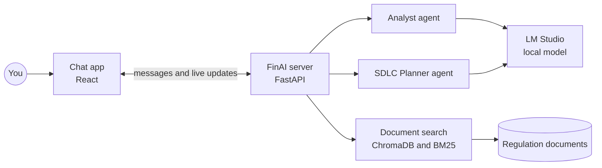
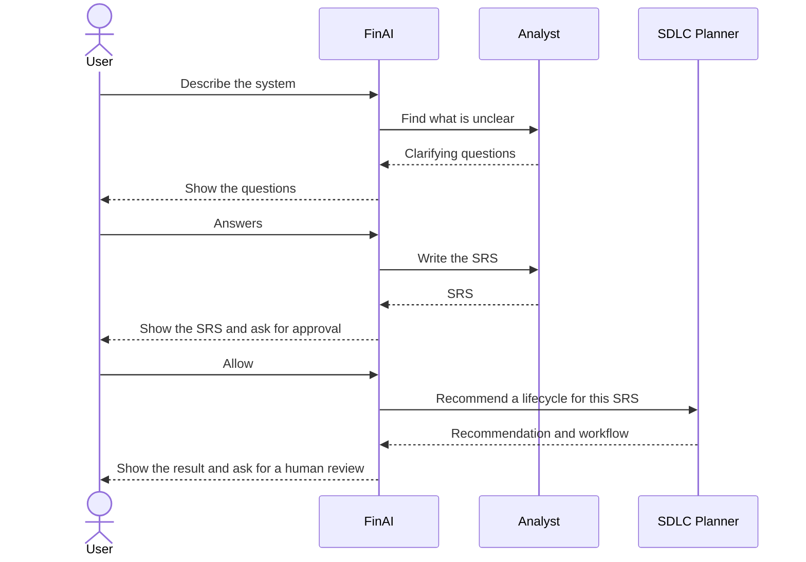

<div align="center">

# FinAI

**Describe a finance system. FinAI writes its software requirements and recommends a development lifecycle.**

[](https://www.python.org)
[](https://google.github.io/adk-docs/)
[](https://fastapi.tiangolo.com)
[](https://lmstudio.ai)
[](https://www.trychroma.com)
[](https://react.dev)
[](https://www.typescriptlang.org)
[](#run-it-locally)

<br>

</div>

## What it does

FinAI is a course project for software engineering. You chat with one assistant, FinAI, and two AI agents do the work behind it:

1. The **Analyst** reads your brief, asks about anything unclear and writes a software requirements specification (SRS).
2. The **SDLC Planner** reads that SRS and recommends a development lifecycle, with a step-by-step workflow.

Everything runs on your own computer. The model runs in LM Studio, and FinAI masks PAN, Aadhaar, card numbers, emails and phone numbers before any text reaches it.

## Features

<table>
<tr>
<td width="50%" valign="top">

### Clarifying questions
The Analyst asks short clarifying questions, one card at a time. Each card has suggested answers, a box for your own answer and a Skip option. A skipped question becomes an open issue in the SRS.

</td>
<td width="50%" valign="top">

### Requirements you can test
The SRS lists requirements with a category, a priority and a measurable acceptance check. FinAI numbers them, flags vague or repeated ones and links each one to a test case in a traceability matrix.

</td>
</tr>
<tr>
<td valign="top">

### Your approval before the hand-off
FinAI stops and asks before it sends the SRS to the planner. Click Allow to continue, or Request changes and type what to revise, and the Analyst writes an updated version.

</td>
<td valign="top">

### SDLC recommendation
FinAI scores seven lifecycles and explains the winner. Tabs show the full ranking, a phased workflow with exit gates, the 13 decision factors and why the other models scored lower.

</td>
</tr>
<tr>
<td valign="top">

### Agent trace & activity
FinAI records every model call and document search. Click the steps link under an agent message (or the activity button in the header) to see how long each step took, how many tokens it used and what went in and out.

</td>
<td valign="top">

### Export & project history
Completed SRS and SDLC documents render as tabbed cards with one-click JSON export, alongside a collapsible sidebar for your recent projects.

</td>
</tr>
</table>

## How it works



The chat app sends your brief to the FinAI server. The server runs the two agents in order and pauses whenever it needs your answer or approval. Both agents are Google ADK agents that call a model running in LM Studio, and every session event is logged to `backend/runs/<session>.jsonl`.

The backend has three files:

| File | What it does |
|---|---|
| `backend/server.py` | Runs the conversation step by step and streams each update to the chat app via SSE. |
| `backend/agents.py` | Defines the two ADK agents and the exact JSON schema (Pydantic) each step must follow. |
| `backend/rules.py` | Holds the parts that need no model: PII masking, hybrid search, SRS validation and SDLC scoring. |

### Document search (RAG)

Before each step, FinAI searches 16 real documents in `backend/corpus/` for the passages that match your brief. They include RBI and SEBI rules, BIAN, ISO 20022, NIST and OWASP security guides, and sample SRS documents from NASA and the World Bank. FinAI runs two searches: keyword search with `rank_bm25` finds exact terms such as "PAN" or "UPI", and ChromaDB (`text-embedding-nomic-embed-text-v1.5`) finds passages with a similar meaning. FinAI merges the two result lists using reciprocal rank fusion and gives the agent the top 5 passages (`E1`–`E5`). A requirement can only cite a passage that the agent actually received, and FinAI marks any uncited claim as `NEEDS-VALIDATION`.

### How the lifecycle is chosen

The SDLC Planner rates 13 factors as Low, Medium or High, such as regulatory pressure, security risk and how often the requirements will change. A fixed scoring table in `rules.py` then scores Waterfall, V-Model, Spiral, Agile, DevSecOps, RAD and a hybrid of Agile and the V-Model. The model does not pick the winner, so the same ratings always give the same ranking. The planner only writes the explanation and the workflow.

## Sequence diagram



## Run it locally

You need [LM Studio](https://lmstudio.ai) with `qwen/qwen3-1.7b` and `text-embedding-nomic-embed-text-v1.5` downloaded, Python 3.12, and Node.js.

```bash
# 1. Start LM Studio and load both models
lms server start --bind 127.0.0.1 --port 1234
lms load qwen/qwen3-1.7b
lms load text-embedding-nomic-embed-text-v1.5

# 2. Start the backend
cd backend
python3.12 -m venv .venv
.venv/bin/python -m pip install -r requirements.txt
.venv/bin/python -m uvicorn server:app --port 8001

# 3. Start the chat app in a second terminal, then open http://127.0.0.1:5173
cd frontend && npm ci && npm run dev
```

On Windows, activate or invoke `.venv\Scripts\python` instead of `.venv/bin/python`.

The first search takes about 30 seconds because FinAI embeds and stores the documents in ChromaDB once at `backend/chroma/`. To change the LM Studio address or the models, copy `backend/.env.example` to `backend/.env` and add `--env-file .env` to the uvicorn command.

The API and more backend details are in [`backend/README.md`](backend/README.md), and frontend build/test commands are in [`frontend/README.md`](frontend/README.md).

## Project structure

```
backend/     server.py, agents.py, rules.py and the corpus/ of documents
frontend/    the React + TypeScript chat app (src/components/, src/lib/, tests/)
```

> [!NOTE]
> FinAI writes drafts. A qualified person must check any reading of a regulation, the final requirements and the choice of lifecycle.
